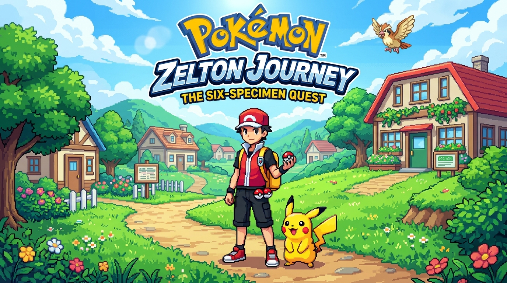
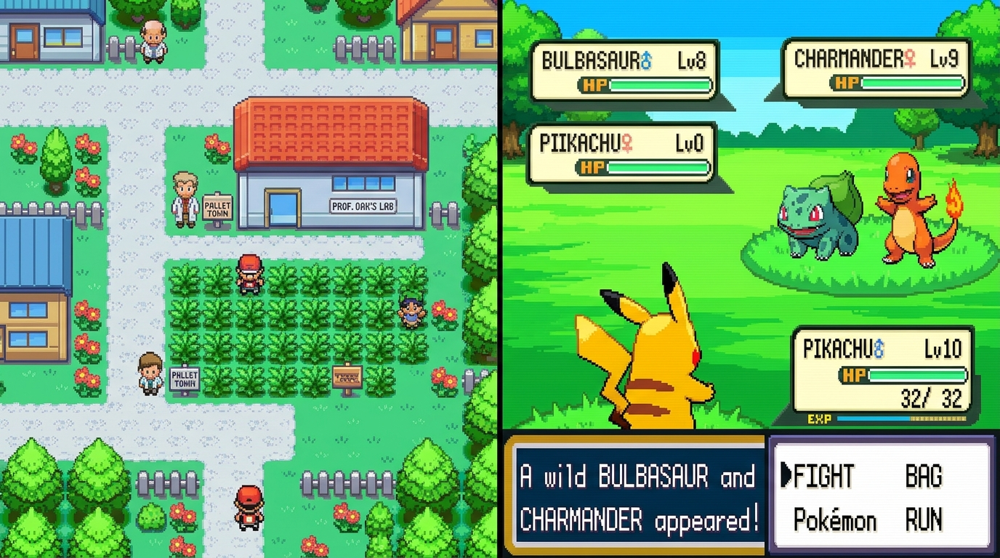

# Pokémon: Zelton Journey — The Six-Specimen Quest

<p align="center">
  
</p>

<p align="center">
  <a href="https://void4ux.github.io/pokemon-zelton-journey/"></a>
  
  
  
  
</p>

---

## 🎮 Play Instantly in Your Browser

👉 **[Launch Pokémon: Zelton Journey on GitHub Pages](https://void4ux.github.io/pokemon-zelton-journey/)**

*Zero installation or downloads required. Runs on desktop browsers (Chrome, Firefox, Safari, Edge) and mobile smartphones with full responsive touch controls.*

---

## 📖 Story & Quest Overview

Welcome to **Zelton Town**, a quaint and peaceful settlement tucked away in a verdant valley. In **Pokémon: Zelton Journey**, you embark on a classic Game Boy Advance top-down RPG adventure inspired by the legendary *Pokémon FireRed*:

1. **Professor Oak's Welcome**: The journey begins with Professor Oak's classic lecture introducing the world of Pokémon.
2. **Awakening in Zelton Town**: Wake up in your 2F bedroom, head downstairs to speak with Mom, and step into the sunlit streets of Zelton.
3. **The Professor's Call**: Visit Professor Oak's Laboratory in southeast Zelton Town. Speak with Oak to claim your starter partner **Lv. 6 Pikachu**, **15 Poké Balls**, **3 Great Balls**, and **3 Potions**.
4. **Northward to Route 1**: Traverse the northern gateway into Route 1, roaming through dense tall grass patches to encounter wild Pokémon.
5. **The Six-Specimen Research Mission**: Catch 6 wild Pokémon to complete the **Research Collection (6/6)**. Hop down the one-way ledges to return to Zelton Town and complete the **Six-Specimen Telemetry Transfer** to earn your **Master Diploma**!

---

## 📸 In-Game Showcase

<p align="center">
  
</p>

---

## ✨ Core Features

- **Authentic GBA Aesthetics**: Rendered at a native 240×160 logical viewport with pixel-perfect nearest-neighbor upscaling, authentic GBA color palette, CRT-style borders, and retro scanline shell.
- **Gen III Turn-Based Battle Engine**:
  - Accurate physical/special damage calculations and type effectiveness.
  - Authentic status ailments: **Paralysis** and **Sleep** (`Thunder Wave`, `Sleep Powder`).
  - GBA-accurate 3-shake capture formula factoring in current HP, ball multipliers, and catch rates.
- **Rich Wild Encounters**:
  - Starter: **Pikachu** (Lv. 6) with *Thunder Shock*, *Growl*, *Quick Attack*, and *Thunder Wave*.
  - Wild Encounters in Route 1 Tall Grass: **Pidgey, Rattata, Caterpie, Bulbasaur, Charmander, Squirtle, and Eevee**.
- **Chiptune Audio Synthesizer**: Custom Web Audio API sound generator producing 8-bit square, triangle, and noise waveforms for title music, battle themes, attack sound FX, Poké Ball clicks, and victory fanfares.
- **Wireless Link Cable Multiplayer**: Real-time Peer-to-Peer 2-player battles powered by PeerJS. Host a room, share your 4-letter room code, and battle a friend remotely!
- **AI Arena Quick Battles**: Jump straight into a simulated Champion Arena battle against AI rival trainers anytime from the multiplayer menu.
- **Mobile Touch GBA Shell**: Full virtual D-pad, A/B action buttons, Start, and Select controls for smartphones and tablets.
- **Persistent Game State**: Seamless auto-saving to browser `LocalStorage` with continue support and save toast notifications.

---

## 🕹️ Controls Guide

| Action | Keyboard Primary | Keyboard Alternative | Mobile Virtual Control |
|:---|:---|:---|:---|
| **Move Up / Down / Left / Right** | `Arrow Keys` | `W` / `S` / `A` / `D` | Virtual D-Pad (Touch & Drag) |
| **A Button (Confirm / Interact / Talk)** | `Z` | `Enter` | `A` Button (Red) |
| **B Button (Cancel / Back)** | `X` | `Backspace` / `Esc` | `B` Button (Blue) |
| **Running Shoes (Hold to Sprint)** | `Shift` (Left or Right) | — | Hold D-Pad Outer Edge |
| **Start (Open In-Game Menu)** | `Enter` | `Escape` | `START` Pill |
| **Select (Secondary Action)** | `Space` | `Tab` | `SELECT` Pill |
| **Audio Toggle** | `M` | Click Speaker Icon | Top HUD Audio Button |

---

## 🗺️ Wild Encounter Table (Route 1)

| Pokémon | Type | Level | Rarity | Notable Moves |
|:---|:---:|:---:|:---:|:---|
| **Pidgey** | Normal / Flying | Lv. 2–4 | Common (35%) | Tackle, Sand Attack, Gust |
| **Rattata** | Normal | Lv. 2–4 | Common (25%) | Tackle, Tail Whip, Quick Attack |
| **Caterpie** | Bug | Lv. 3 | Common (15%) | Tackle, String Shot |
| **Bulbasaur** | Grass / Poison | Lv. 4 | Rare (7%) | Tackle, Growl, Vine Whip, Sleep Powder |
| **Charmander** | Fire | Lv. 4 | Rare (7%) | Scratch, Growl, Ember |
| **Squirtle** | Water | Lv. 4 | Rare (7%) | Tackle, Tail Whip, Water Gun |
| **Eevee** | Normal | Lv. 5 | Ultra-Rare (4%) | Tackle, Tail Whip, Quick Attack, Sand Attack |

---

## 🛠️ Local Development & Running Offline

The entire game is bundled into a lightweight, standalone web application with embedded base64 sprites and asset fallback systems.

### Option 1: Instant Python Server
```bash
# Clone the repository
git clone https://github.com/void4ux/pokemon-zelton-journey.git
cd pokemon-zelton-journey

# Launch local server
python3 -m http.server 8080
```
Open [http://localhost:8080](http://localhost:8080) in your web browser.

### Option 2: Node.js & Vite Dev Server
```bash
npm install
npm run dev
```

---

## 📦 Project Architecture

```
pokemon-zelton-journey/
├── index.html                  # Complete standalone GBA web application
├── banner.jpg                  # High-resolution hero title banner
├── gameplay.jpg                # Gameplay preview and feature showcase
├── package.json                # Project dependencies and npm scripts
├── tsconfig.json               # TypeScript configuration
├── vite.config.ts              # Vite bundle and asset pipeline config
├── .github/
│   └── workflows/
│       └── deploy.yml          # Automated GitHub Pages deployment pipeline
├── public/
│   ├── assets/
│   │   ├── banner.jpg
│   │   ├── gameplay.jpg
│   │   └── sprites/            # Extracted GBA sprites (NPCs, Pokémon, UI)
│   └── pokemon_zelton_journey.html
└── src/                        # Modular engine sources
    ├── main.ts
    ├── game/config.ts
    ├── scenes/
    ├── entities/
    ├── systems/
    └── ui/
```

---

## 📜 Disclaimer & Credits

- *Pokémon* and *Pokémon FireRed* are registered trademarks of **Nintendo**, **Game Freak**, and **Creatures Inc.**
- This project is a non-commercial, educational fan tribute created out of passion for classic Game Boy Advance pixel art, retro chiptune audio, and nostalgic game architecture.
- Built with ❤️ by **void4ux**.
